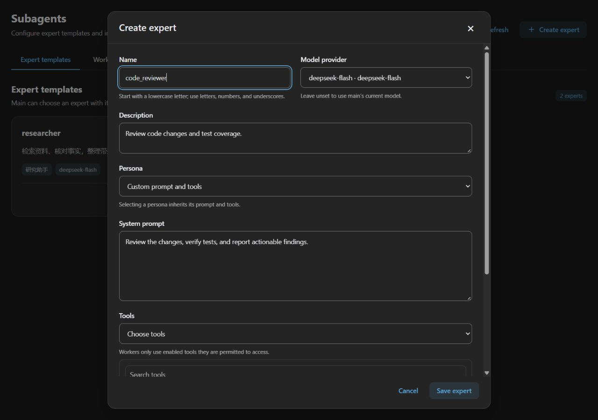

# Subagent Plugin {#agent-handoff-and-subagent}

Asynchronous delegation is provided by the independent `astrbot_plugin_subagent` plugin for AstrBot's built-in Agent. It requires the core Agent lifecycle SDK update. Subagents provided by external Agent services remain configured in those services. Legacy expert discovery and reload remain available only for plugin SDK compatibility; core main no longer mounts legacy experts automatically.

## Install and configure {#configuration}

Upload the plugin ZIP through **Extensions → Plugins**, then open **Subagent → Settings**. Main can autonomously create generic workers or select configured expert templates.

Templates support a name, public description, persona, system prompt, provider, and tools. A selected persona supplies its prompt, preset dialogue, and tools. An empty tool list means no tools. Main retains its own tools; expert configuration no longer removes tools from main.

Open **Subagent management → Expert templates** from the plugin detail page and click **Create expert**. Enter a name and description, then select a provider and persona. Alternatively, write a custom prompt and choose all, specific, or no tools. Saving updates available templates immediately while tasks already started continue running. The list supports editing, enabling, disabling, and deleting experts.

The page follows AstrBot Dashboard styling and light/dark themes. The screenshot uses sample settings.

## Execution and follow-up

`spawn_agent` submits the first task together with creation and returns a worker ID immediately. Workers run concurrently while main continues independent work.

| Tool | Purpose |
| --- | --- |
| `spawn_agent` | Start a generic worker or select an expert template |
| `list_agents` | Read states and completed steps within the current sender and conversation |
| `wait_agent` | Wait for any/all workers; timeout leaves workers running |
| `get_agent_result` | Read repeatable results or errors |
| `send_message` | Steer an active turn, or automatically start another turn if complete or input remains unconsumed |
| `cancel_agent` | Cancel one worker independently |

Users communicate with workers through main. Workers do not automatically inherit main's full history: include the necessary context, constraints, and expected output in the task. Workers retain a private history and stable ID, but cannot recursively spawn workers.

Defaults: 3 concurrent workers per session, a 600-second timeout including queue time, and 30 steps per turn capped by main's limit. `wait_agent` accepts 0–60000 ms and `any` / `all`. Timing out a wait never cancels a worker.

## Inspect progress

Open **Extensions → Plugins → Subagent → Subagent management → Worker progress** to inspect states, turns, completed steps, results, and execution records. This tab is read-only and uses AstrBot's standard plugin API authentication and permissions.

The screenshot uses sample records to demonstrate the layout.

An active main receives results at complete step boundaries. An idle main resumes through AstrBot's existing event queue, bound to the original session, conversation, and sender. The plugin validates the current CID before enqueueing, during recovery, and when handling wakeups. Switching conversations prevents automatic wakeups for the old conversation and never redirects its results. Platform capabilities still determine proactive delivery; see [Proactive Capabilities](./proactive-agent.md).

## Interruption and recovery

States, completed steps, and pending input persist in AstrBot's database. After restart or plugin reload, unfinished workers become `interrupted`; possibly executed tools are never automatically replayed. Main can inspect and resume them through `send_message`.

Delivery is at least once: abnormal exits can cause duplicates. Stopping a session cancels its background work. Cancelling one worker leaves main and its siblings running. Cancelling a worker does not additionally terminate background Shell processes it has started; Shell sessions use AstrBot's existing management tools and process timeouts.

## Migration

| Previous entry | Replacement |
| --- | --- |
| Extensions → SubAgents | Plugin detail → Subagent management → Expert templates; execution limits remain in plugin settings |
| Built-in SubAgent page | Plugin detail → Subagent management (view ID: `runtime`) |
| Legacy `transfer_to_*` experts | Available through the plugin compatibility SDK; core main no longer mounts them |
| Core `subagent_orchestrator` configuration | Only `agents` data is retained for legacy plugins; optionally copy definitions into the new plugin's `agents`, and use `enabled` |

Native expert mounting, `main_enable`, tool deduplication, and the router prompt are removed. The legacy `agents` data slot remains so configuration cleanup does not discard definitions needed by existing plugins. The old `/api/v1/subagents/*` and `/api/subagent/*` routes are removed; the new plugin uses standard plugin APIs.

The legacy `@agent` / `register_agent`, `RegisteringAgent`, and `HandoffTool` SDK interfaces remain supported for existing plugins, including nested tools and foreground/background execution. `Context.subagent_orchestrator`, its constructor argument, configuration loading, and `reload_from_config()` are also retained so existing plugins can discover and invoke legacy experts. These interfaces are deprecated in favor of the plugin's worker tools.
