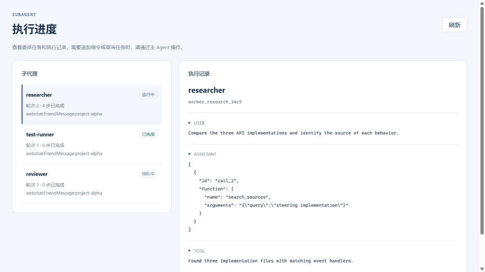

# Subagent 插件 {#agent-handsoff-与-subagent}

异步子代理能力由独立的 `astrbot_plugin_subagent` 插件提供，适用于 AstrBot 内置 Agent。需要包含 Agent 生命周期 SDK 更新的核心版本；外部 Agent 服务的子代理仍在对应服务中配置。旧的配置驱动专家和编排器继续保留，以兼容现有插件。

## 安装与配置 {#configuration}

在 **扩展 → 插件**中上传插件 ZIP，打开 **Subagent → 设置**。启用插件后，主 Agent 可以自主创建通用 worker，也可以选择配置好的专家模板。

专家模板可以设置名称、用途说明、人格、系统提示词、模型提供商和工具列表。使用人格时采用人格提示词、预设对话和工具；空工具列表表示不用工具。主 Agent 保留自己的工具，不再按专家配置去重。

## 执行与交互

`spawn_agent` 将第一条任务与创建请求一起提交，立即返回 worker ID。多个 worker 可并行运行，主 Agent 可以继续独立工作。

| 工具 | 用途 |
| --- | --- |
| `spawn_agent` | 创建通用 worker 或使用专家模板 |
| `list_agents` | 查看当前发送者、当前对话内的状态和完成步数 |
| `wait_agent` | 等待任意或全部完成；超时不取消任务 |
| `get_agent_result` | 读取结果或错误，可重复读取 |
| `send_message` | 追加指令：运行中 steering，已结束或本轮未消费时自动开新 turn |
| `cancel_agent` | 单独取消一个 worker |

用户通过主 Agent 传达追加指令。子代理不会自动继承主 Agent 的全部历史，因此委派任务需包含必要背景、约束和预期输出。worker 保留独立历史和相同 ID，但不能递归创建子代理。

默认每个会话最多同时执行 3 个 worker；超时 600 秒，包含排队时间；每轮最多 30 步，不超过主 Agent 上限。`wait_agent` 支持 0–60000 毫秒以及 `any` / `all`，等待超时不影响后台执行。

## 查看进度

打开 **扩展 → 插件 → Subagent → runtime** 查看状态、轮次、完成步数、结果和执行记录。进度视图只读，访问权限沿用 AstrBot 标准插件接口的认证与权限校验。

图中使用示例记录展示布局。

主 Agent 运行中在完整 step 边界接收完成结果；空闲时通过原有事件队列继续工作，结果绑定原来的会话、对话和发送者。插件在入队前、重启恢复及处理唤醒事件时校验当前 CID；切换到其他对话后不再自动唤醒原对话，也不会将结果改投其他对话。主动消息送达还取决于平台能力，参见[主动能力](./proactive-agent.md)。

## 中断与恢复

状态、完整步骤和待消费消息保存在 AstrBot 数据库中。重启或插件重载后，未完成任务标记为 `interrupted`，不会自动重放可能已执行过的工具。主 Agent 检查后可通过 `send_message` 继续。

结果按至少一次方式交付，异常退出时可能重复。会话停止会取消所属后台任务，单独取消 worker 不影响主 Agent 或其他 worker。取消 worker 不会额外终止其已启动的后台 Shell，Shell 会话沿用 AstrBot 原有的管理工具和进程超时机制。

## 旧入口迁移

| 旧入口 | 新入口 |
| --- | --- |
| 扩展 → 子代理 | 扩展 → 插件 → Subagent → 设置 |
| 核心子代理页面 | 插件详情 → runtime |
| 旧专家生成的 `transfer_to_*` | 保留兼容；新的异步 worker 使用 `spawn_agent` |
| `subagent_orchestrator` 核心配置 | 保留兼容；也可将专家定义复制到插件的 `agents`，启用项使用 `enabled` |

工具去重开关不再移除主 Agent 的工具。旧的 `main_enable` 开关和编排路由提示词仍用于旧专家挂载。旧的 `/api/v1/subagents/*`、`/api/subagent/*` 接口已移除，新插件使用标准插件接口。

为兼容现有插件，保留旧 SDK 的 `@agent` / `register_agent`、`RegisteringAgent` 和 `HandoffTool`，以及嵌套工具绑定、前台和后台执行。同时保留 `Context.subagent_orchestrator` 属性、构造参数、旧配置加载和 `reload_from_config()`，已有插件仍可获取和调用旧专家。这些接口标记为弃用，新开发优先使用插件的 worker 工具。
